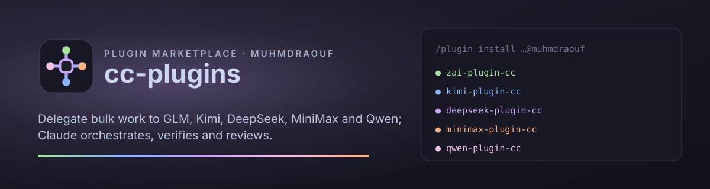

<p align="center">
  
</p>

<p align="center">
  <a href="https://github.com/MuhmdRaouf/claude-code-plugins/actions/workflows/ci.yml"></a>
  <a href="LICENSE"></a>
  <a href="https://code.claude.com/docs/en/plugins"></a>
  <a href="https://go.dev/"></a>
  <a href="https://nodejs.org/"></a>
</p>

<p align="center">
  <a href="https://github.com/sponsors/MuhmdRaouf"></a>&nbsp;&nbsp;<a href="https://buymeacoffee.com/muhmdraouf"></a>
</p>

A [Claude Code](https://code.claude.com) plugin marketplace with three jobs:

- **Delegate:** hand bulk work to other providers' models while Claude keeps the planning and the review.
- **Verify:** background jobs run in isolated git worktrees behind mechanical gates; nothing lands without a review
  Claude decides.
- **Watch:** the session hub, the radar dashboard and the kanban board install with every plugin.

## Find your next step

| I want to… | Start here |
|---|---|
| Install a plugin | [Quick start](#quick-start) |
| Choose a provider or model | [Delegate to other models](#delegate-to-other-models) |
| Run verified background jobs, or use omp, opencode, pi or ZCode | [Background jobs](#background-jobs) |
| See sessions, requests and cost | [Huddle, radar and kanban](#huddle-radar-and-kanban) |
| Understand or maintain my setup | [How the plugins fit together](#how-the-plugins-fit-together) · [Update](#update) · [Uninstall](#uninstall) |
| Contribute | [Development](#development) · [Architecture](plugins.md) |

## Quick start

1. Add the marketplace and install a plugin in Claude Code:

   ```text
   /plugin marketplace add MuhmdRaouf/claude-code-plugins
   /plugin install zai-plugin-cc@muhmdraouf
   ```

2. Restart Claude Code.
3. Run the plugin's setup command from the table below.

- Installing a provider plugin installs [huddle](https://github.com/MuhmdRaouf/huddle) with it, no extra command.
- Provider plugins take the key from `<PROVIDER>_API_KEY` (for example `ZAI_API_KEY`, `KIMI_API_KEY`), the OS
  keystore, or a one-time page in your browser, in that order. See the
  [API key](plugins/zai-plugin-cc/README.md#api-key) section of each plugin's README. Nothing else needs
  configuring.
- From a terminal: `claude plugin marketplace add MuhmdRaouf/claude-code-plugins`, then
  `claude plugin install zai-plugin-cc@muhmdraouf`. Add `--scope project` to enable a plugin for one repository.

## Plugins

### Delegate to other models

Each provider plugin adds two native Claude Code agents: a main model for implementation and bulk edits, and a
flash model for simpler tasks. Four optional worker wrappers delegate verified background jobs to other tools.

| Plugin | Provider | Agents | Setup |
|---|---|---|---|
| [zai-plugin-cc](plugins/zai-plugin-cc) | GLM (Z.ai) | `zai:glm-5.3`, `zai:glm-5.3-flash` | `/zai:setup` |
| [kimi-plugin-cc](plugins/kimi-plugin-cc) | Kimi (Moonshot AI) | `kimi:kimi-k3`, `kimi:kimi-k2.6` | `/kimi:setup` |
| [deepseek-plugin-cc](plugins/deepseek-plugin-cc) | DeepSeek | `deepseek:deepseek-v4-pro`, `deepseek:deepseek-flash` | `/deepseek:setup` |
| [minimax-plugin-cc](plugins/minimax-plugin-cc) | MiniMax | `minimax:MiniMax-M3`, `minimax:MiniMax-M2.7-highspeed` | `/minimax:setup` |
| [qwen-plugin-cc](plugins/qwen-plugin-cc) | Qwen (Alibaba Cloud) | `qwen:qwen3.8-max`, `qwen:qwen3.8-flash` | `/qwen:setup` |

Commands every provider plugin has (`<p>` is `zai`, `kimi`, `deepseek`, `minimax` or `qwen`):

| Command | What it does |
|---|---|
| `/<p>:board` | What runs now: sessions, subagents and jobs |
| `/<p>:usage` | Tokens, estimated cost and router health |
| `/<p>:review [job id]` | Review a finished background job |
| `/<p>:setup:omp`, `:opencode`, `:pi`, `:zcode` | Hand jobs to omp, opencode, pi or ZCode, run as you set them up |
| `/<p>:remove` | Turn the plugin off |

The job loop's verbs (`run`, `wait`, `batch`, `accept`, `return`, `discard`, …) run through the plugin's
launcher; the loop has no slash commands of its own except `/<p>:board` and `/<p>:review`. Each plugin's README
covers the loop.

### Background jobs

- A brief is Markdown with YAML front matter. A detached driver runs the job in its own git worktree.
- The worker is headless `claude -p` against the provider, or omp, opencode, pi or ZCode as you set them up.
- The plugin runs the brief's gates and checks the diff against its `scope` and `forbid` globs; every attempt ends
  in a verdict, and every job ends in `awaiting_review`.
- Claude accepts, returns with feedback or discards. Acceptance is never automatic, and accepting lands one
  verified commit.

[plugins.md](plugins.md) covers every plugin in depth; [packages/core/ARCHITECTURE.md](packages/core/ARCHITECTURE.md)
holds the engine's design.

### Huddle, radar and kanban

Every provider plugin declares huddle as a dependency, so installing one brings the three with it — no extra
command. `claude plugin uninstall <plugin>@muhmdraouf --prune` removes huddle again once no installed plugin
needs it.

| What | What it does |
|---|---|
| [huddle](https://github.com/MuhmdRaouf/huddle) | Channels where sessions and the subagents they start work as one team: messages, tasks that wait on each other, approvals and a live dashboard |
| radar | A zero-token dashboard of every session, request, tool call and estimated cost: budgets, alerts, a request inspector |
| kanban | The board behind `/<p>:board`: cards sessions claim and move through review and testing |

- Radar's dashboard reads the spool each router appends to, one line per request under `~/.agents/radar/spool/`
  (`$RADAR_HOME` moves it): model, route, status, latency and tokens, never headers or bodies.
- A radar budget set to stop refuses that provider's models with a 400 naming `/huddle:open`, until it is lifted
  or its period ends. `claude-*` requests are never affected.
- The dashboard is a local page that follows your system's light or dark mode.

## How the plugins fit together

- Proxy mode is the default: setup points Claude Code's `HTTPS_PROXY` at the router and hands it a per-user local
  CA through `NODE_EXTRA_CA_CERTS`, so `ANTHROPIC_BASE_URL` stays unset and Remote Control (`claude rc`) keeps
  working. Base-URL mode is the fallback, beside a proxy or a CA of your own.
- Each provider plugin runs its own router on `127.0.0.1`: zai 18787, kimi 18788, deepseek 18789, minimax 18790,
  qwen 18791.
- The router sends that provider's models to the provider with your key, another provider plugin's models to that
  plugin's router in one hop, and every `claude-*` model on to Anthropic byte for byte.
- The router supervises itself: hooks bring it back after a crash or a power loss, before the next prompt, tool
  call or subagent, and it degrades to passthrough rather than cut Claude Code off.
- The engine is one static binary, `plugin-core`: `/<p>:setup` downloads it from the plugin's GitHub release,
  checks its sha256 and keeps it under `~/.agents/core/<version>/` (`AGENTS_CORE_HOME` moves it).
- State lives in one root per plugin, `~/.agents/<p>` (`$<P>_STATE_DIR` overrides it), shared by hooks, commands
  and the router.

## Update

- Run `/plugin marketplace update muhmdraouf`, then restart Claude Code.

## Uninstall

### Provider plugins

Recommended: turn the plugin off first, then uninstall it.

1. Run `/<p>:remove` (for example `/zai:remove`).
2. Run `/plugin uninstall <plugin>@muhmdraouf` (for example `zai-plugin-cc@muhmdraouf`).

`/<p>:remove` restores everything setup changed, from the ledger it kept before changing it:

- The proxy keys (or the base URL, in base-URL mode) come out of `~/.claude/settings.json`; the rest stays.
- The plugin's agents get back the models they had before setup, and the provider's models leave `/model`.
- The key setup stored is deleted from the OS keystore.
- The router retires: sessions already open keep working through it, and it exits once they close (after 7 days at
  most).

Uninstalled without `/<p>:remove` first:

- The router notices the plugin is gone and does the same cleanup on its own, from the ledger setup kept, then
  removes its files and exits.
- Disabling the plugin cleans up the same way; enabling it again re-applies the setup at the next session start.
- If a session still misbehaves, restart Claude Code: it then starts from the restored settings.

### huddle, radar and kanban

- Run `claude plugin uninstall <plugin>@muhmdraouf --prune`: huddle goes once no installed plugin needs it, and
  with it the hub, the radar dashboard and the board server stop and remove their runtime files.
- What stays behind, for a later install to pick up or for you to delete: huddle's home (`~/.config/huddle`, or
  `$HUDDLE_HOME`) with its channels, radar's state (`~/.agents/radar`, or `$RADAR_HOME`), and each project's
  `.agents/kanban` board and `.agents/huddle` settings.

### Remove the marketplace

- After uninstalling every plugin, run `/plugin marketplace remove muhmdraouf`.

## Requirements

- Claude Code, with the `claude` CLI on `PATH`: the setup ping and job workers run through `claude -p`.
- No runtime of its own: plugin-core is one static binary. macOS and Linux, on amd64 and arm64.
- git, for edit jobs, which run in git worktrees.
- An API key for the provider. Keys live in the OS keystore (macOS Keychain, Linux Secret Service); a key file
  with mode 0600 is the fallback where no keystore answers.

## Development

`mise run setup` installs the pinned tools and the pre-commit hook once per clone; `npm ci` installs the locked
dependencies.

| Check or build | Command from the repository root |
|---|---|
| Every gate CI runs (lint, static checks, all tests) | `mise run check` |
| Every npm workspace (attribution, siblings and CI contracts first) | `npm run check` |
| One provider plugin | `npm run check -w plugins/zai-plugin-cc` |
| The engine's Go suite | `(cd packages/core && go test ./...)` |
| One test | `(cd plugins/zai-plugin-cc && npx vp test -t "test name")` |
| Rewrite a provider launcher after a launcher or release change | `npm run build -w plugins/zai-plugin-cc` |
| Load a local plugin in Claude Code | `claude --plugin-dir ./plugins/zai-plugin-cc/plugin` |

- Development needs Node 22.3 or later and Go; the shared suites build the plugin-core binary with
  `packages/core/scripts/host-build.sh`.
- The provider launchers (`plugin/dist/run`) are committed, so installs need no build step.
- The five provider plugins are hand-written copies; `npm run check:siblings` keeps them in step.
- [AGENTS.md](AGENTS.md) has the rules for commits and coding agents. [plugins.md](plugins.md) covers every
  plugin in depth. Shared packages: [core](packages/core/README.md).

## Trademarks

- This is an independent project, not affiliated with, endorsed by or sponsored by Anthropic or any model provider.
- Claude and Claude Code are trademarks of Anthropic, PBC.
- GLM and Z.ai, Kimi and Moonshot AI, DeepSeek, MiniMax, Qwen and Alibaba Cloud, omp, opencode, pi and ZCode
  belong to their respective owners. They are named only to say what the plugins work with.
- The provider plugins call each provider's public API with your own key. Your use is subject to that provider's
  terms and pricing.

## Support

<p align="center">
  If these plugins make your day a little easier, you can say thanks here:
</p>

<p align="center">
  <a href="https://github.com/sponsors/MuhmdRaouf"></a>&nbsp;&nbsp;<a href="https://buymeacoffee.com/muhmdraouf"></a>
</p>

- Bugs and ideas: [open an issue](https://github.com/MuhmdRaouf/claude-code-plugins/issues).

## License

[GPL-3.0-or-later](LICENSE). Copyright © 2026 [Raouf](https://github.com/MuhmdRaouf).
